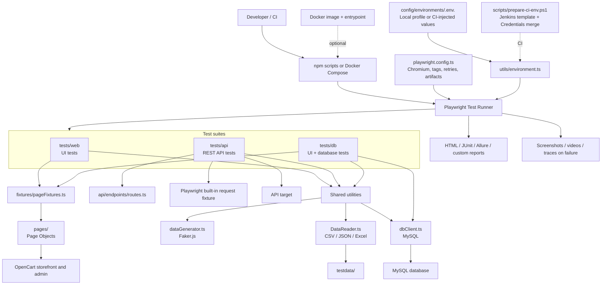
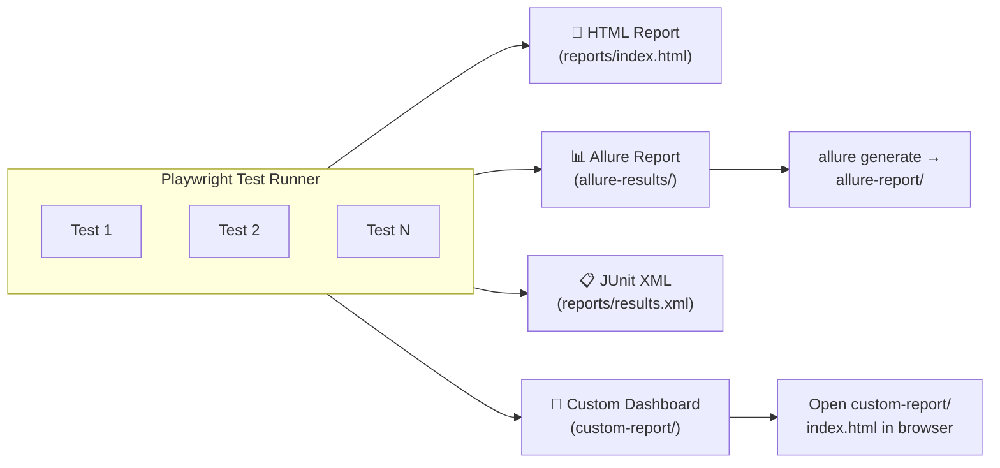
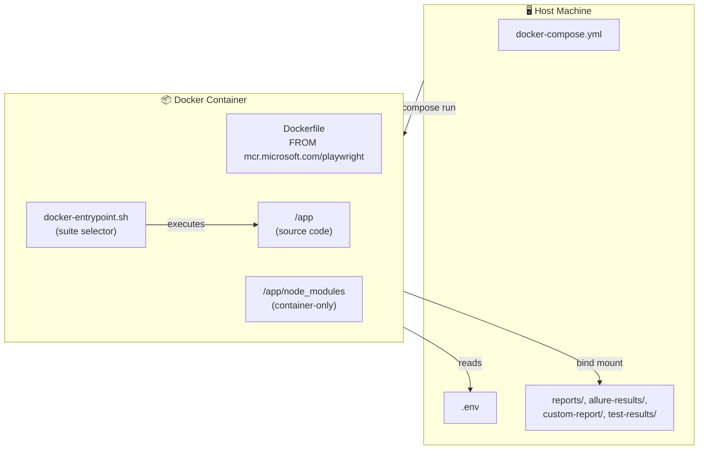

# 🎭 Playwright + TypeScript Automation Framework

> **A production-grade, multi-layer test automation framework** for **Web UI**, **REST API**, and **Database** testing — built with Playwright, TypeScript, and the Page Object Model pattern.

[](https://playwright.dev)
[](https://www.typescriptlang.org/)
[](https://allurereport.com/)
[](https://www.jenkins.io/)
[](https://www.docker.com/)
[](https://nodejs.org/)

---


## 📖 Table of Contents

- [🎭 Playwright + TypeScript Automation Framework](#-playwright--typescript-automation-framework)
  - [📖 Table of Contents](#-table-of-contents)
  - [🎯 Overview](#-overview)
  - [✨ Key Features](#-key-features)
  - [🏗️ Framework Architecture](#️-framework-architecture)
  - [📁 Project Structure](#-project-structure)
    - [📂 Folder Breakdown](#-folder-breakdown)
  - [🛠️ Tech Stack](#️-tech-stack)
  - [📋 Prerequisites](#-prerequisites)
  - [🚀 Quick Start](#-quick-start)
    - [1️⃣ Clone the Repository](#1️⃣-clone-the-repository)
    - [2️⃣ Install Dependencies](#2️⃣-install-dependencies)
    - [3️⃣ Install Playwright Browsers](#3️⃣-install-playwright-browsers)
    - [4️⃣ Configure Environment](#4️⃣-configure-environment)
    - [5️⃣ Run the Master Suite](#5️⃣-run-the-master-suite)
  - [🔧 Environment Configuration](#-environment-configuration)
  - [🏷️ Test Suites \& Tags](#️-test-suites--tags)
  - [▶️ Running Tests](#️-running-tests)
    - [Run All Tests](#run-all-tests)
    - [Run by Tag (npm scripts)](#run-by-tag-npm-scripts)
    - [Run in Headed Mode (with browser visible)](#run-in-headed-mode-with-browser-visible)
    - [Run with Debugging](#run-with-debugging)
    - [Run a Single Test File](#run-a-single-test-file)
    - [Run with Specific Project / Browser](#run-with-specific-project--browser)
    - [Run with grep (custom tag filter)](#run-with-grep-custom-tag-filter)
    - [Run in CI Mode (headless, 2 retries, 1 worker)](#run-in-ci-mode-headless-2-retries-1-worker)
  - [🔄 Test Execution Flow](#-test-execution-flow)
  - [🔌 Product API Test Flow](#-product-api-test-flow)
  - [📊 Reporting](#-reporting)
  - [🐳 Docker Setup](#-docker-setup)
    - [Docker Architecture](#docker-architecture)
    - [Build the Image](#build-the-image)
    - [Run Test Suites](#run-test-suites)
    - [Pass Extra Playwright Arguments](#pass-extra-playwright-arguments)
    - [Key Docker Features](#key-docker-features)
  - [🚇 CI/CD with Jenkins](#-cicd-with-jenkins)
  - [🔧 Utilities](#-utilities)
  - [📋 Coding Guidelines](#-coding-guidelines)
  - [CI - Git Hub Copilot](#ci---git-hub-copilot)
  - [CI using Jenkins Pipeline](#ci-using-jenkins-pipeline)
  - [👨‍🏫 Author](#-author)

---

## 🎯 Overview

This framework provides a **unified, scalable automation solution** for testing the **OpenCart e-commerce platform** across three layers:

| Layer           | Technology                                  | What We Test                                                                       |
| --------------- | ------------------------------------------- | ---------------------------------------------------------------------------------- |
| 🌐 **Web UI**   | Playwright + Page Object Model              | Customer registration, login/logout, product search, cart management, admin portal |
| 🔌 **REST API** | Playwright `request` fixture + FakeStoreAPI | Product, user, cart, and authentication endpoint checks with response assertions   |
| 🗄️ **Database** | MySQL2 + Admin Portal                       | End-to-end customer registration with DB verification                              |

It is designed for **CI/CD integration** (Jenkins + Docker), supports **multiple reporting formats**, and follows **industry best practices** for maintainability and readability.

---

## ✨ Key Features

- ✅ **Page Object Model (POM)** — 12 reusable page classes for clean test code
- ✅ **Custom Test Fixtures** — Type-safe dependency injection for all page objects
- ✅ **Multi-Layer Testing** — Web UI + REST API + Database in a single framework
- ✅ **Tag-Based Test Suites** — `@sanity`, `@regression`, `@api`, `@web`, `@e2e`, `@master`, `@datadriven`
- ✅ **Data-Driven Testing** — CSV, JSON, and Excel test data sources
- ✅ **Random Test Data Generation** — Powered by Faker.js
- ✅ **API Response Assertions** — Status, response shape, and field checks in API specs
- ✅ **Accessibility Checks** — WCAG compliance testing via axe-core
- ✅ **Multiple Reporters** — HTML, Allure, Custom HTML dashboard
- ✅ **Parallel Execution** — Fully parallel test execution with configurable workers
- ✅ **CI/CD Ready** — Jenkins pipeline + Docker Compose support
- ✅ **Retries & Artifacts** — Automatic retries, screenshots, videos, and traces on failure

---

## 🏗️ Framework Architecture



---

## 📁 Project Structure
<table>
  <tr>
    <td>
      
      <br/>
      
    </td>
  </tr>
</table>


### 📂 Folder Breakdown

```text
.
├── .github/
│   ├── agents/                       # Playwright test planner, generator, and healer agents
│   └── workflows/                    # GitHub Actions setup and Playwright workflow
├── api/
│   ├── endpoints/routes.ts           # Central API route constants
│   └── schemas/                      # Optional API JSON schemas
├── config/environments/
│   ├── .env.dev.example              # Safe dev profile template
│   ├── .env.qa.example               # Safe QA profile template
│   └── .env.uat.example              # Safe UAT profile template
├── docs/                             # Framework, Docker, Jenkins, and usage guides
├── fixtures/pageFixtures.ts          # Custom fixtures that provide web page objects
├── pages/                            # Web Page Object classes
├── prompts/                          # Local test-generation prompts (ignored by Git)
├── scripts/prepare-ci-env.ps1        # Validates/merges CI profile and secrets; creates Docker env file when needed
├── tests/
│   ├── api/                          # API specs using Playwright's built-in request fixture
│   ├── db/                           # Database-backed end-to-end specs
│   └── web/                          # Browser UI specs
├── testdata/                         # CSV/JSON test data
├── utils/
│   ├── environment.ts                # Selects local profile or validates CI-injected environment values
│   ├── dataGenerator.ts              # Faker-backed values and API payloads
│   ├── DataReader.ts                 # CSV, JSON, and Excel readers
│   ├── dbClient.ts                   # MySQL access
│   └── CustomReporter.ts             # Custom Playwright reporter
├── .dockerignore / .gitignore         # Docker build exclusions and Git ignore rules
├── Dockerfile                         # Playwright test image
├── docker-compose.yml                 # Test service and report mounts
├── docker-entrypoint.sh               # Maps suite names to Playwright/npm commands
├── Jenkinsfile                        # Direct Playwright execution on a Jenkins agent
├── Jenkinsfile.docker                 # Docker Compose execution from Jenkins
├── package.json / package-lock.json   # Dependencies and npm scripts/lockfile
├── playwright.config.ts               # Test discovery, environment URL, project, tags, and reporters
├── playwright-mcp-context.md          # AI-assisted test-generation conventions
└── tsconfig.json                      # TypeScript compiler settings
```

Local environment files (`config/environments/.env.dev`, `.env.qa`, and `.env.uat`)
are created from the matching example templates and are ignored by Git. Keep real
credentials only in those local files or in Jenkins Credentials, never in the
checked-in `.example` templates.

| Path | Purpose |
| --- | --- |
| `config/environments/*.example` | Checked-in, non-secret environment templates for dev, QA, and UAT |
| `utils/environment.ts` | Loads the selected local profile; in CI, validates variables injected by the pipeline |
| `scripts/prepare-ci-env.ps1` | Merges a selected template with Jenkins credentials and validates required settings |
| `Jenkinsfile` | Installs dependencies/Chromium and runs the selected suite directly on the agent |
| `Jenkinsfile.docker` | Uses the CI helper and Docker Compose to build and run the selected suite |
| `.github/workflows/` | GitHub Actions setup and test workflow definitions |
| `prompts/` | Local test-generation prompts; ignored by Git and not part of the CI checkout |
| `reports/`, `allure-results/`, `custom-report/`, `test-results/` | Generated reports and failure artifacts; created or populated during runs |

---

## 🛠️ Tech Stack

Versions below are based on the installed dependencies (`npm ls --depth=0`) and the current development environment. The Node.js and npm versions describe this machine; they are not pinned by the project.

| Technology                                                           | Installed version | Purpose                          |
| -------------------------------------------------------------------- | ----------------- | -------------------------------- |
| [Playwright Test](https://playwright.dev/)                           | 1.64.1             | Browser automation & API testing |
| [Playwright CLI](https://www.npmjs.com/package/@playwright/cli)      | 0.1.22             | Browser automation from CLI      |
| [TypeScript](https://www.typescriptlang.org/)                        | 7.0.2    | Test code is written in TypeScript; no TypeScript compiler dependency is declared |
| [Node.js](https://nodejs.org/)                                       | 24.15.0            | Runtime on the current system    |
| [npm](https://www.npmjs.com/)                                        | 11.12.1            | Package manager on the current system |
| [Allure Playwright](https://www.npmjs.com/package/allure-playwright) | 3.14.0             | Allure reporting integration    |
| [Faker.js](https://fakerjs.dev/)                                     | 10.6.0             | Random test data generation      |
| [AJV](https://ajv.js.org/)                                           | 8.20.0             | Optional JSON Schema validation support |
| [axe-core](https://www.npmjs.com/package/@axe-core/playwright)       | 4.14.0             | Accessibility testing            |
| [Luxon](https://moment.github.io/luxon/)                             | 3.7.2              | Date/time manipulation           |
| [MySQL2](https://www.npmjs.com/package/mysql2)                       | 3.24.6             | MySQL database connectivity      |
| [csv-parse](https://www.npmjs.com/package/csv-parse)                 | 7.0.3              | CSV file parsing                 |
| [xlsx](https://www.npmjs.com/package/xlsx)                           | 0.18.5             | Excel file parsing               |
| [dotenv](https://www.npmjs.com/package/dotenv)                       | 18.0.8             | Environment variable management  |

---

## 📋 Prerequisites

Before you begin, ensure you have the following installed:

- **Node.js** v20 or later → [Download](https://nodejs.org/)
- **npm** v9+ (comes with Node.js)
- **Git** → [Download](https://git-scm.com/)
- **Playwright browsers** (installed via setup script)
- **Docker Desktop** (optional, for containerized execution) → [Download](https://www.docker.com/products/docker-desktop/)
- **Java 11+** (optional, for Allure reporting) → [Download](https://adoptium.net/)

---

## 🚀 Quick Start

### 1️⃣ Clone the Repository

```bash
git clone <repository-url>
cd playwright-opencart-ai
```

### 2️⃣ Install Dependencies

```bash
npm install
```

### 3️⃣ Install Playwright Browsers

```bash
npx playwright install --with-deps
```

### 4️⃣ Configure Environment

```bash
cp config/environments/.env.qa.example config/environments/.env.qa
```

Edit the local `.env.qa` profile with the appropriate environment values and
credentials. Keep this un-suffixed profile file uncommitted. The same pattern
applies to dev and UAT; see [Environment Configuration](#-environment-configuration).

### 5️⃣ Run the Master Suite

```bash
npm run test:master
```

---

## 🔧 Environment Configuration

Choose one of the supported profiles: `dev`, `qa`, or `uat`. For a local run,
copy the matching checked-in template (for example
`config/environments/.env.qa.example`) to `.env.qa` in the same folder and fill in
the environment-specific values. The un-suffixed profile files are ignored by Git.
Set `APP_ENV` to the profile name; locally it defaults to `qa` when omitted.
`utils/environment.ts` loads the matching local profile. In CI, variables are
injected by the pipeline instead of loading the local profile.

The checked-in templates contain safe, non-secret settings. Add account credentials
to the ignored local profile only when needed; Jenkins obtains secrets from Jenkins
Credentials. A profile contains fields such as:

```env
APP_ENV=qa
WEB_APP_URL=<QA web application URL>
API_BASE_URL=https://fakestoreapi.com
ADMIN_APP_URL=<QA admin URL>
DB_HOST=<database host reachable by the test runner>
DB_PORT=<database port>
DB_NAME=<database name>
```

For Docker database suites, `DB_HOST` must resolve from inside the container;
`localhost` refers to the test container itself.

---
## 🏷️ Test Suites & Tags

Tests are organized using Playwright's tag system (`@tag-name` in test titles). Each tag maps to a reusable npm script:

| Tag           | npm Script                | Description                                  |
| ------------- | ------------------------- | -------------------------------------------- |
| `@master`     | `npm run test:master`     | **Master suite** — all critical tests        |
| `@sanity`     | `npm run test:sanity`     | **Sanity checks** — quick smoke tests        |
| `@regression` | `npm run test:regression` | **Full regression** — comprehensive coverage |
| `@web`        | `npm run test:web`        | **Web UI tests only**                        |
| `@api`        | `npm run test:api`        | **API tests only**                           |
| `@e2e`        | `npm run test:e2e`        | **End-to-end scenarios**                     |
| `@datadriven` | `npm run test:datadriven` | **Data-driven tests**                        |

Tests can carry **multiple tags** for flexible execution:

```typescript
test('Valid Login Flow @master @sanity @regression @web', async (...) => { ... });
test('GET - All Products @master @sanity @api', async (...) => { ... });
test('Register customer, verify in admin portal and MySQL @master @end-to-end @db', async (...) => { ... });
```

---

## ▶️ Running Tests

### Run All Tests

```bash
npx playwright test --grep ".*"
```

`playwright.config.ts` defaults to `@master`, so plain `npx playwright test`
runs the master-tagged tests. Use `--grep ".*"` to override that default and run
all discovered tests.

### Run by Tag (npm scripts)

```bash
npm run test:sanity          # Sanity tests only
npm run test:regression      # Regression tests
npm run test:web             # Web UI tests
npm run test:api             # API tests
npm run test:e2e             # End-to-end tests
npm run test:master          # Master suite
npm run test:datadriven      # Data-driven tests
```

### Run in Headed Mode (with browser visible)

```bash
npx playwright test --grep "@master" --headed
```

### Run with Debugging

```bash
npm run test:sanity:debug    # Opens Playwright Inspector
```

### Run a Single Test File

```bash
npx playwright test tests/web/valid-login.spec.ts
```

### Run with Specific Project / Browser

```bash
npx playwright test --project=chromium
```

### Run with grep (custom tag filter)

```bash
npx playwright test --grep "@sanity"
npx playwright test --grep "@api|@web"    # Multiple tags
```

### Run in CI Mode (headless, 2 retries, 1 worker)

```bash
set CI=true && npx playwright test
```

---

## 🔄 Test Execution Flow


## 🔌 Product API Test Flow

`tests/api/products.spec.ts` runs a serial CRUD workflow using Playwright's built-in
`request` fixture. It does not use the custom web page fixtures or load a JSON schema.

```text
Playwright config / selected environment
        ↓
tests/api/products.spec.ts
        ├── utils/environment.ts → validates APP_ENV and provides API_BASE_URL
        ├── utils/dataGenerator.ts → creates POST and PUT product payloads
        └── api/endpoints/routes.ts → supplies product endpoint paths
        ↓
Playwright's built-in { request } fixture
        ↓
FakeStoreAPI product endpoints
        ↓
Status-code and response-field assertions in the spec
```

The tests execute in this order:

1. **GET all products** — requests `Routes.GET_ALL_PRODUCTS` and checks the status,
   array response, and required product fields.
2. **POST a product** — generates a payload with `DataGenerator`, checks the response,
   and stores the returned product ID.
3. **GET a configured product** — uses `PRODUCT_ID` (default `1`) and checks the
   returned product fields. This is separate from the ID returned by the POST.
4. **PUT the created product** — generates an updated payload and uses the ID captured
   from the POST response.
5. **DELETE the created product** — sends the delete request using that captured ID.

`api/schemas/product_api_schema.json` exists in the repository, but this spec does not
load it or perform JSON-schema validation; it checks response fields directly.


## 📊 Reporting

The framework generates **four types of reports** simultaneously:




## 🐳 Docker Setup

Run tests in a **consistent, isolated container environment** — no local dependencies needed.

### Docker Architecture



### Build the Image

```bash
docker compose build
```

### Run Test Suites

```bash
# Run all tests
docker compose run --rm playwright-tests

# Run specific suites
docker compose run --rm playwright-tests sanity
docker compose run --rm playwright-tests regression
docker compose run --rm playwright-tests web
docker compose run --rm playwright-tests api
docker compose run --rm playwright-tests master
docker compose run --rm playwright-tests e2e
docker compose run --rm playwright-tests datadriven
```

### Pass Extra Playwright Arguments

```bash
docker compose run --rm playwright-tests web --headed --workers 2
```

### Key Docker Features

- **Layer caching** — `package*.json` copied first, `npm ci` cached unless deps change
- **Bind mounts** — Reports and artifacts persist on the host
- **Container-only `node_modules`** — Not shadowed by host bind mount
- **Entrypoint script** — Maps suite names to npm scripts automatically

---

## 🚇 CI/CD with Jenkins

Two Declarative pipelines are provided:

| Pipeline file | Execution mode | What it does |
| --- | --- | --- |
| `Jenkinsfile` | Direct on the Jenkins agent | Installs npm dependencies and Chromium, prepares environment values, then runs the selected Playwright suite |
| `Jenkinsfile.docker` | Docker Compose | Uses `scripts/prepare-ci-env.ps1` to combine the selected safe profile template with Jenkins Credentials, builds the `playwright-tests` image, and runs the selected suite in a one-off container |

Both pipelines accept `APP_ENV` (`dev`, `qa`, `uat`) and `TEST_SUITE`
(`all`, `master`, `api`, `web`, `e2e`, `datadriven`, `uidb`). The `all` option
overrides the default `@master` filter to run all discovered tests; `uidb` selects
the `@uidb` tests. The Docker pipeline also requires Docker Compose on its agent.

The checked-in GitHub Actions workflow has not yet been migrated to this profile
setup: it still expects a root `.env.example` and does not inject the required
environment selection and secrets. Do not rely on it for these environment
profiles until it is updated.

Configure Jenkins Credentials using the IDs expected by the pipeline:
`opencart-<environment>-env`, `opencart-<environment>-api`, and, for database
suites, `opencart-<environment>-admin` and `opencart-<environment>-db`. The
environment helper validates required settings and removes the temporary Compose
environment file after the Docker run. Reports are written to the configured
workspace folders; the current pipeline files do not include Jenkins report
archiving or publishing stages.

---

## 🔧 Utilities

| Utility          | File                      | Purpose                                                                 |
| ---------------- | ------------------------- | ----------------------------------------------------------------------- |
| `DataGenerator`  | `utils/dataGenerator.ts`  | Generate random names, emails, passwords, and API payloads via Faker.js |
| `DataProvider`   | `utils/DataReader.ts`     | Read test data from CSV, JSON, and Excel files                          |
| `environment`   | `utils/environment.ts`    | Selects a local profile or validates CI-injected environment variables  |
| `executeQuery`   | `utils/dbClient.ts`       | Execute MySQL queries with parameterized inputs                         |
| `CustomReporter` | `utils/CustomReporter.ts` | Custom Playwright reporter generating a rich HTML dashboard             |

---

## 📋 Coding Guidelines

- Follow the **Page Object Model** pattern for all UI interactions
- Use **tags** (`@tag`) to categorize every test
- Write **descriptive test names** and use `test.step()` for multi-step scenarios
- Keep **locators in page objects** — never in test files
- Use **fixtures** for dependency injection — never instantiate page objects manually
- Add **JSDoc comments** to all public methods
- Run `npx playwright test` locally before submitting

---
## CI - Git Hub Copilot


## CI using Jenkins Pipeline


## 👨‍🏫 Author

<div >
    <h3>Charudatt Pimple </h3>
    <p><em>SDET</em></p>

</div>

---
